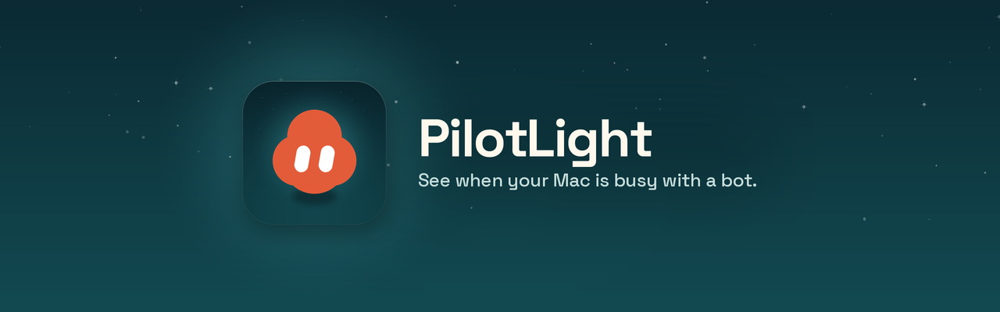
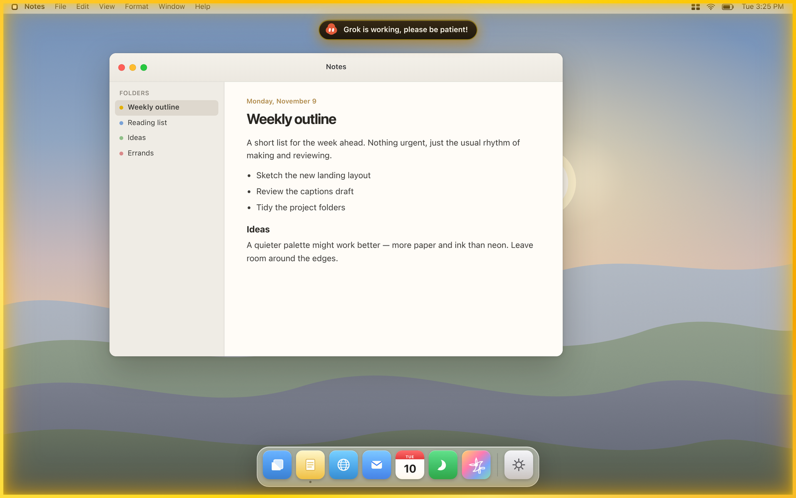

# PilotLight

<p align="center">
  
</p>

<p align="center">See when your Mac is busy with a bot.</p>

<p align="center">
  
</p>

A tiny macOS menu bar app that draws a click-through yellow glow around the
screen while an agent is using the Mac.

The border exists so a person can still use the computer, and can tell at a
glance when an agent is driving it. Clicks, scrolling, and typing pass straight
through the overlay.

The on-screen label reads: **Grok is working**

See the [quick start](QUICKSTART.md) to install it and to copy the instructions
you can give an agent.

## Requirements

- macOS 13 or later
- Apple Silicon or Intel
- Xcode Command Line Tools (or Xcode) to build

## Install

From a checkout of this repository:

```bash
./Scripts/build.sh
./Scripts/install.sh
```

That will:

- Build `PilotLight.app` (ad-hoc signed)
- Copy it to `~/Applications/PilotLight.app`
- Install the CLI at `~/bin/pilotlight`
- Add `~/bin/grok-border` as a symlink alias
- Load a LaunchAgent (`com.bashframes.pilotlight`) so the app starts at login

The installer never uses `sudo`. If `/usr/local/bin` is writable without
elevated privileges, it also places a `pilotlight` symlink there. Otherwise
call the CLI with its full path, `~/bin/pilotlight`, or add `~/bin` to your
`PATH` yourself.

To remove only PilotLight (the app, CLI, alias, and LaunchAgent):

```bash
./Scripts/uninstall.sh
```

## For agents

Before driving this Mac, turn the border on. Ping during long work so a run
that lasts more than 20 minutes does not look stale and hide itself. Always
turn it off when you are done, including after a failure.

```bash
~/bin/pilotlight on
~/bin/pilotlight ping
~/bin/pilotlight off
```

Or wrap a command so the border cannot be left on:

```bash
~/bin/pilotlight run -- ./your-script
```

`~/bin/grok-border` is an alias for the same command.

The trigger is a flag file at `~/.grok-working`. The app is a background
agent (`LSUIElement`); do not activate it, click it, or change system UI in
order to show the border. Creating or removing the flag is enough.

| Command | Effect |
| --- | --- |
| `pilotlight on` | Create the flag and show the border |
| `pilotlight off` | Remove the flag and hide the border |
| `pilotlight status` | Print `on`, `off`, or `stale` (and the flag age) |
| `pilotlight ping` | Refresh the flag's modification time |
| `pilotlight run -- <cmd…>` | Turn on, run the command, always turn off afterwards |

If the flag is older than 20 minutes, PilotLight hides the border automatically
so a crashed agent cannot leave it stuck. A later `ping` or `on` (which
touches the flag) shows it again.

## Menu bar

Ember, a small terracotta bun, sits in the menu bar while PilotLight is running
(it is a template image, so it follows the menu bar's light or dark appearance):

- A status line (`On`, `Off`, `Stale (hidden)`, or `Test`)
- **Hide Border Now** — removes the flag and hides the overlay
- **Show Test Border for 5s** — previews the overlay without leaving the flag behind
- **Quick Start…** — the first-run setup window (also opens on the first launch)
- **Settings…** — border style (Soft Glow, Pilot Line, Lamp, Corner Lamps), glow color (Yellow, Amber, Blue, Green, Pink, White), and intensity
- **Tip Jar** — opens the same Ko-fi page Lodge uses, in your default browser
- **Quit** — exits the app (the LaunchAgent does not restart it until the next login, or until the CLI starts it again)

## Behavior

- One borderless, transparent window per display, including displays that are
  added or removed later
- Window level is above ordinary windows; it joins every Space and can appear
  over full-screen apps
- The overlay ignores mouse events, is excluded from Command-Tab and Mission
  Control, and never becomes the key or main window
- A gentle opacity pulse on the glow runs only while the border is visible;
  when it is hidden, that animation stops so idle CPU stays near zero
- Show and hide fade over about 0.3 seconds

## Build

`./Scripts/build.sh` compiles the AppKit sources with `swiftc` and produces
`build/PilotLight.app`. A `Package.swift` is included so editors can treat the
sources as a Swift package; the bundled app is still produced by the build
script, not by `swift build`.

The app icon is Ember on a teal night, generated from a single 1024×1024 PNG
at `Resources/AppIcon-source.png`. To swap it, replace that file and run:

```bash
python3 Scripts/generate-app-icon.py
```

Or point at another PNG:

```bash
PILOTLIGHT_ICON_SOURCE=/path/to/icon-1024.png python3 Scripts/generate-app-icon.py
```

That regenerates `Resources/AppIcon.iconset` and `Resources/AppIcon.icns`.
Do not apply an extra squircle mask — the source already has transparent corners.

Copy the official Ember menu-bar template images (`MenuIcon.png` and
`MenuIcon@2x.png`) into `Resources/` with:

```bash
python3 Scripts/generate-assets.py
```

## Design

The default look is the yellow Glow style: a soft, static gold bloom that
follows the screen's rounded corners (about 12 points on built-in displays),
and a dark gold pill centered just under the menu bar. Ember sits in the
pill and, while the border is on, plays a short loop: a gentle bob, a blink,
then a look left and right. There is no spinning or rotating frame. Glow
color can be changed in Settings with six presets (Yellow is the default). A Style picker offers Soft Glow (the default), Pilot Line, Lamp, and Corner Lamps. Pilot Line is a single inset stroke; its thickness can be set in Settings when that style is selected. Intensity can be changed there too; the default intensity is
softer than the original mockup.

<p align="center">
  
</p>

<!-- Product screenshots (uncomment when the files are in docs/images/screenshots/):
<p align="center">
  
</p>
<p align="center">
  
</p>
<p align="center">
  
</p>
<p align="center">
  
</p>
<p align="center">
  
</p>
-->

## License

MIT. Copyright (c) 2026 Sebastian Phillips (bashframes).
